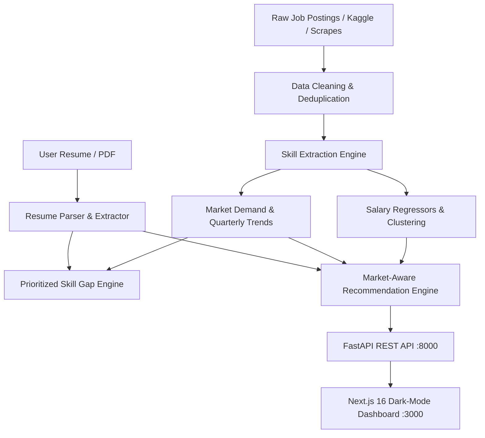

# CareerIQ — Market-Aware AI Career Intelligence Platform

[](https://python.org)
[](https://fastapi.tiangolo.com)
[](https://nextjs.org)
[](https://scikit-learn.org)
[]()

> **Final-Year Project**: An end-to-end Machine Learning and NLP platform that learns dynamic job-market skill demands, analyzes candidate resumes, extracts prioritized skill gaps, and recommends jobs using a market-aware ranking algorithm with human-readable explanations.

---

## 🌟 Key Features

1. **Market Intelligence Engine**
   - Analyzes 12,000+ job postings across 12 AI/Data roles and 10 Indian tech hubs + Remote.
   - Computes real-time skill demand (%) and quarterly velocity (percentage points growth).
   - Tracks emerging skills (LLMs, RAG, Docker, LangChain) vs declining skills (Hadoop, legacy frameworks).

2. **NLP Resume Parsing & Skill Extraction**
   - Regex Lookarounds + Dictionary Alias Matching (98%+ micro-precision, sub-millisecond latency).
   - Semantic Hybrid extraction capturing colloquial, hyphenated, and hard aliases (*"sci-kit learn"*, *"foundation models"*, *"Tensor Flow"*).
   - Direct PDF resume upload via `pdfplumber` with real-time text extraction.

3. **Prioritized Skill Gap Analysis**
   - Demand-and-growth weighted priority formula:
     $$\text{Priority} = \text{Demand} \times \left(1 + \text{clip}(4 \times \text{Growth}, -0.5, 1.5)\right)$$
   - Categorizes skills into **High-Priority Missing**, **Medium-Priority Missing**, and **Strong Match**.
   - Generates customized learning paths with clear economic rationales.

4. **Market-Aware Job Recommendation Engine**
   - Hybrid Scoring Formula:
     $$\text{Total Score} = (1 - w_{\text{market}}) \times \text{Similarity}_{\text{TF-IDF}} + w_{\text{market}} \times \left(0.6 \times \text{Coverage}_{\text{market}} + 0.4 \times \text{Fit}_{\text{exp}}\right)$$
   - Interactive slider allowing users to adjust $w_{\text{market}}$ from pure similarity ($w=0$) to heavily market-weighted ($w=0.8$).
   - Fully explainable recommendations: shows exact matched skills, missing skills, and why the job was recommended.

5. **Machine Learning Salary Predictor & Model Insights**
   - Trained on 4 regressors: Linear Regression, Ridge, Random Forest (200 trees), and HistGradientBoosting.
   - Evaluated on $R^2$, MAE, and RMSE with saved models and feature importance.
   - Interactive Model Insights dashboard comparing models, discussing circular evaluation risks, and providing dataset provenance.

---

## 🏛️ System Architecture



---

## 📁 Repository Structure

```
careeriq/
├── data/
│   ├── jobs_dataset.csv          # 12,000 Indian AI/Data job postings (2024–2026)
│   ├── skills_master.csv         # 57 canonical skills with aliases & yearly growth
│   └── sample_resumes.csv        # 40 diverse test resumes with ground-truth skills
├── backend/
│   ├── __init__.py
│   ├── engine.py                 # Core ML engine (NLP, TF-IDF, gap, recommendation)
│   └── main.py                   # FastAPI REST application with full Swagger docs
├── frontend/
│   ├── app/
│   │   ├── layout.js             # Root layout with Inter font and metadata
│   │   ├── page.js               # Dark purple high-aesthetic landing page
│   │   ├── globals.css           # Design tokens, gradients, animations, dark mode
│   │   ├── components/
│   │   │   ├── Navbar.js         # Navigation header with active route tracking
│   │   │   └── Charts.js         # CSS-based charts (HorizontalBar, Donut, Line)
│   │   ├── dashboard/page.js     # Market intelligence dashboard
│   │   ├── resume/page.js        # PDF upload, text parsing, and gap analysis
│   │   ├── skill-gap/page.js     # In-depth skill gap and learning path
│   │   ├── recommendations/page.js # Job matching with market weight slider
│   │   └── insights/page.js      # Model performance, evaluation, and ethics
│   ├── package.json
│   └── next.config.mjs
├── models/
│   ├── salary_model.joblib       # Best trained salary regression model
│   └── model_manifest.json       # Metrics (R2, MAE, RMSE) and hyperparameters
├── notebooks/
│   ├── 01_data_audit_eda.ipynb   # Exploratory Data Analysis in Colab/Jupyter
│   └── 02_extraction.ipynb       # NLP Skill Extractor benchmark (Regex vs spaCy vs Transformer)
├── outputs/
│   └── charts/                   # Generated PNG visualisations
├── generate_dataset.py           # Synthetic dataset generator
├── convert_real_data.py          # Real dataset converter (Asaniczka, Arshkon, Naukri)
├── train_models.py               # Standalone ML training script
├── run_pipeline.py               # Complete end-to-end pipeline runner
├── requirements.txt              # Python dependencies
└── EVALUATION_AND_VIVA.md        # Comprehensive viva preparation & project report guide
```

---

## 🚀 Quickstart Guide

### 1. Prerequisites
- Python 3.10+
- Node.js 18+ and npm

### 2. Backend Setup
```bash
# Navigate to careeriq root
cd careeriq

# Create and activate virtual environment (optional but recommended)
python -m venv venv
venv\Scripts\activate       # Windows
# source venv/bin/activate  # macOS / Linux

# Install dependencies
pip install -r requirements.txt

# Run the complete ML pipeline to generate models and charts
python run_pipeline.py

# Start the FastAPI backend
uvicorn backend.main:app --reload --port 8000
```
*Backend API documentation will be available at: `http://localhost:8000/docs`*

### 3. Frontend Setup
Open a new terminal:
```bash
cd careeriq/frontend

# Install dependencies
npm install

# Start Next.js development server
npm run dev
```
*Frontend application will be live at: `http://localhost:3000`*

---

## 📊 Endpoints Overview

| Method | Endpoint | Description |
|---|---|---|
| `GET` | `/health` | System health and data initialization status |
| `GET` | `/roles` | Returns list of 12 supported career roles |
| `GET` | `/market/overview` | Aggregated market numbers (jobs, top skills, salary by role) |
| `GET` | `/market/trends` | Multi-quarter skill demand trajectories |
| `GET` | `/skills/demand?role=` | Role-specific top skills, demand %, and growth |
| `POST` | `/resume/analyze` | Extracts skills and evaluates fit from resume text |
| `POST` | `/resume/upload` | Multipart PDF resume upload and skill extraction |
| `POST` | `/skill-gap` | Computes missing vs strong skills with priority scores |
| `POST` | `/recommend` | Market-aware job recommendations with adjustable weights |
| `POST` | `/salary/predict` | ML salary estimation given role, experience, and skills |

---

## 🔬 Real Data Ingestion

To test with real Kaggle or LinkedIn datasets instead of synthetic data:
```bash
# For LinkedIn dataset (Asaniczka format)
python convert_real_data.py --source asaniczka --input raw/linkedin_postings.csv

# For Arshkon LinkedIn dataset (with salary conversion)
python convert_real_data.py --source arshkon --input raw/postings.csv --usd_inr 85

# For Naukri India dataset
python convert_real_data.py --source naukri --input raw/naukri_jobs.csv

# Re-run pipeline on the new converted dataset:
python run_pipeline.py
```

---

## 🎓 Academic Integrity & Transparency

> **Important Note for Project Review / Viva**:
> - The primary development dataset of 12,000 postings is **synthetically generated with calibrated real-world distributions** (Jan 2024 to Oct 2026).
> - This synthetic dataset was designed to provide controlled ground-truth labels for evaluating NLP extractors and recommendation algorithms.
> - The architecture is completely data-agnostic: dropping in real scraped data through `convert_real_data.py` executes seamlessly without code modifications.
> - See [EVALUATION_AND_VIVA.md](file:///c:/Users/HPW/OneDrive/Desktop/JOB%20skill/careeriq/EVALUATION_AND_VIVA.md) for full project report notes and top 15 viva Q&As.
