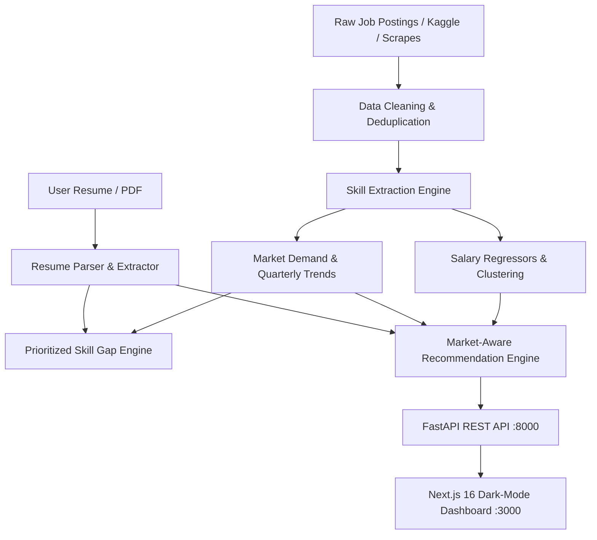

 An end-to-end Machine Learning and NLP platform that learns dynamic job-market skill demands, analyzes candidate resumes, extracts prioritized skill gaps, and recommends jobs using a market-aware ranking algorithm with human-readable explanations.

---

## 🌟 Key Features

1. **Market Intelligence Engine**
   - Analyzes 12,000+ job postings across 12 AI/Data roles and 10 Indian tech hubs + Remote.
   - Computes real-time skill demand (%) and quarterly velocity (percentage points growth).
   - Tracks emerging skills (LLMs, RAG, Docker, LangChain) vs declining skills (Hadoop, legacy frameworks).

2. **NLP Resume Parsing & Skill Extraction**
   - Regex Lookarounds + Dictionary Alias Matching (98%+ micro-precision, sub-millisecond latency).
   - Semantic Hybrid extraction capturing colloquial, hyphenated, and hard aliases (*"sci-kit learn"*, *"foundation models"*, *"Tensor Flow"*).
   - Direct PDF resume upload via `pdfplumber` with real-time text extraction.

3. **Prioritized Skill Gap Analysis**
   - Demand-and-growth weighted priority formula:
     $$\text{Priority} = \text{Demand} \times \left(1 + \text{clip}(4 \times \text{Growth}, -0.5, 1.5)\right)$$
   - Categorizes skills into **High-Priority Missing**, **Medium-Priority Missing**, and **Strong Match**.
   - Generates customized learning paths with clear economic rationales.

4. **Market-Aware Job Recommendation Engine**
   - Hybrid Scoring Formula:
     $$\text{Total Score} = (1 - w_{\text{market}}) \times \text{Similarity}_{\text{TF-IDF}} + w_{\text{market}} \times \left(0.6 \times \text{Coverage}_{\text{market}} + 0.4 \times \text{Fit}_{\text{exp}}\right)$$
   - Interactive slider allowing users to adjust $w_{\text{market}}$ from pure similarity ($w=0$) to heavily market-weighted ($w=0.8$).
   - Fully explainable recommendations: shows exact matched skills, missing skills, and why the job was recommended.

5. **Machine Learning Salary Predictor & Model Insights**
   - Trained on 4 regressors: Linear Regression, Ridge, Random Forest (200 trees), and HistGradientBoosting.
   - Evaluated on $R^2$, MAE, and RMSE with saved models and feature importance.
   - Interactive Model Insights dashboard comparing models, discussing circular evaluation risks, and providing dataset provenance.

---

## 🏛️ System Architecture



---


## 🚀 Quickstart Guide

### 1. Prerequisites
- Python 3.10+
- Node.js 18+ and npm

### 2. Backend Setup
```bash
# Navigate to careeriq root
cd careeriq

# Create and activate virtual environment (optional but recommended)
python -m venv venv
venv\Scripts\activate       # Windows
# source venv/bin/activate  # macOS / Linux

# Install dependencies
pip install -r requirements.txt

# Run the complete ML pipeline to generate models and charts
python run_pipeline.py

# Start the FastAPI backend
uvicorn backend.main:app --reload --port 8000
```

## 📊 Endpoints Overview


---

## 🔬 Real Data Ingestion

To test with real Kaggle or LinkedIn datasets instead of synthetic data:
```bash
# For LinkedIn dataset (Asaniczka format)
python convert_real_data.py --source asaniczka --input raw/linkedin_postings.csv

# For Arshkon LinkedIn dataset (with salary conversion)
python convert_real_data.py --source arshkon --input raw/postings.csv --usd_inr 85

# For Naukri India dataset
python convert_real_data.py --source naukri --input raw/naukri_jobs.csv


